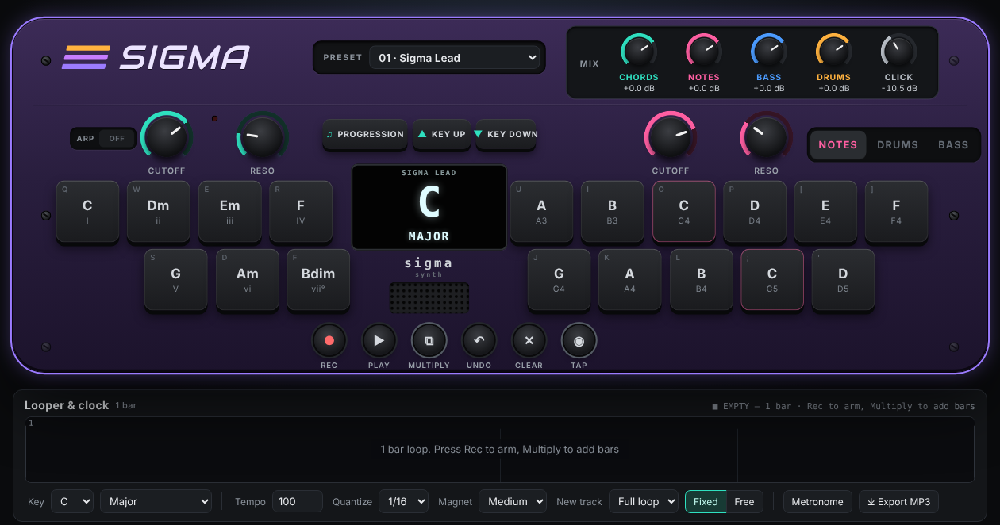

# SigmaSynth

**▶ Play it online: https://strikelines.github.io/SigmaSynth/** · Repo: https://github.com/StrikeLines/SigmaSynth

A browser-based synth and looper. Play chords with your left hand and notes, drums or bass with your right on the computer keyboard (or MIDI), then layer them into loops and export to MP3. It's a single self-contained web page, so there's nothing to install.
